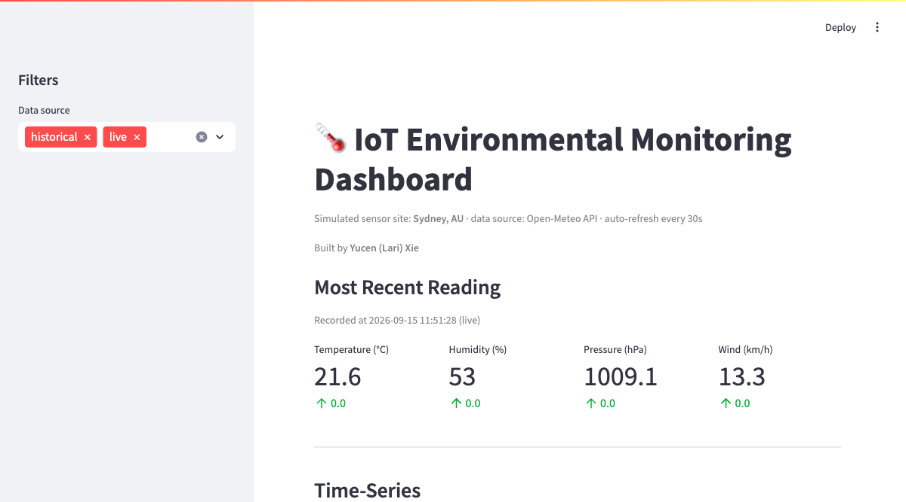
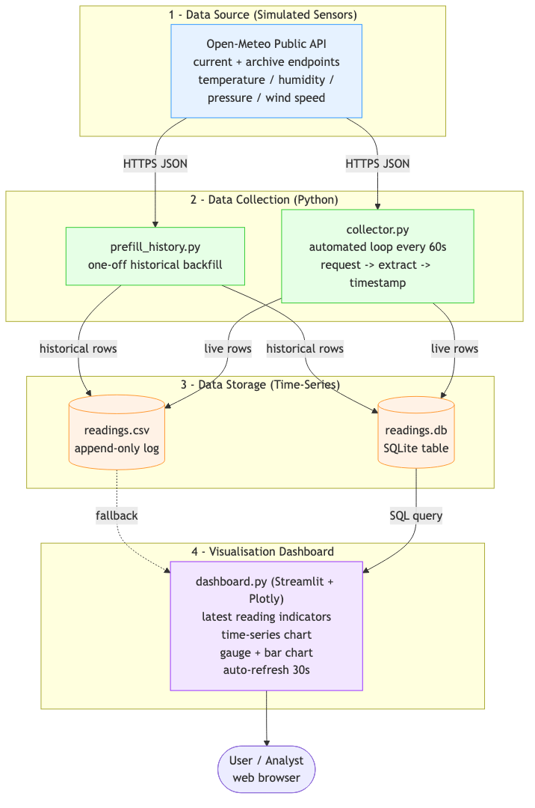

# 🌡️ IoT Environmental Monitoring — Data Pipeline

A simulated **IoT environmental monitoring system** that collects live weather data from a public API, stores it as a growing time-series, and visualises it on a real-time, auto-refreshing dashboard. Built to mirror how production IoT platforms ingest, store, and monitor sensor data — without physical hardware.

<p align="center">
  
</p>

> **Live demo:** [iot-env-monitor-xie.streamlit.app](https://iot-env-monitor-xie.streamlit.app/) · **Author:** Yucen (Lari) Xie

---

## ✨ Highlights

- **End-to-end data pipeline** — ingest → process → store → visualise
- **Live API ingestion** on a fixed schedule (simulated sensor feed)
- **Dual storage** — CSV *and* SQLite, with idempotent, de-duplicated writes
- **Real-time dashboard** — latest readings, time-series chart, gauge & bar chart, auto-refresh
- **Containerised** — one-command run with Docker / Finch (Python 3.12)
- **Cloud-ready** — the dashboard self-collects when deployed to Streamlit Cloud
- **Tested** — unit tests for the storage layer

## 🧱 Architecture

```
Open-Meteo API  →  Python collector  →  CSV + SQLite  →  Streamlit dashboard  →  User
```

<p align="center">
  
</p>

Each stage has a single responsibility and communicates through a well-defined interface (an HTTP response or a stored row), so any stage can be swapped without rewriting the others.

## 🛠️ Tech Stack

| Layer | Technology |
|---|---|
| Language | Python 3.12 |
| Data source | [Open-Meteo API](https://open-meteo.com/) (free, no API key) |
| Storage | SQLite + CSV |
| Dashboard | Streamlit + Plotly |
| Packaging | Docker / Finch, docker-compose |

## 📁 Project structure

```
iot-env-monitor/
├── src/
│   ├── config.py           # central configuration (location, API, paths)
│   ├── storage.py          # CSV + SQLite writer with de-duplication
│   ├── prefill_history.py  # one-off historical backfill (baseline)
│   ├── collector.py        # automated live collection loop ("the sensor")
│   └── dashboard.py        # Streamlit + Plotly live dashboard
├── tests/
│   └── test_storage.py     # unit tests for the storage layer
├── assets/                 # images for this README
├── requirements.txt
├── Dockerfile
├── docker-compose.yml
└── README.md
```

## 🚀 Quickstart

### Option 1 — Docker / Finch (recommended)

```bash
docker compose up --build          # add -d to run in the background
```

Starts three services sharing a data volume:
- `prefill` — backfills 7 days of history, then exits
- `collector` — collects a live reading every 60s (auto-restarts)
- `dashboard` — served at **http://localhost:8501**

Stop with `docker compose down`.

### Option 2 — Local Python

The collector and dashboard run **at the same time** (two terminals); the dashboard refreshes itself every 30s.

```bash
python3 -m venv .venv && source .venv/bin/activate
pip install --only-binary=:all: -r requirements.txt

# terminal 1 — baseline, then continuous live collection
python src/prefill_history.py --days 7
python src/collector.py

# terminal 2 — dashboard
streamlit run src/dashboard.py
```

## 📊 Dashboard features

- **Most recent reading** — temperature, humidity, pressure, wind (with deltas)
- **Time-series chart** — selectable metric, coloured by historical vs live
- **Temperature gauge** and **average-by-hour bar chart**
- **Auto-refresh** every 30 seconds — new readings appear on their own

## ☁️ Deploy to Streamlit Community Cloud

The dashboard is built to run standalone in the cloud: with no separate collector and an ephemeral filesystem, it **seeds the historical baseline and appends a fresh live reading itself** whenever data is stale (`ensure_fresh_data()` in `src/dashboard.py`).

1. Push this repo to GitHub.
2. Go to https://share.streamlit.io → **New app** → select the repo/branch.
3. Set **Main file path** to `src/dashboard.py` → **Deploy**.
4. (Optional) add `SELF_COLLECT="1"` in the app's secrets to force a live fetch on every refresh.

## 🧪 Tests

```bash
python tests/test_storage.py        # or: python -m pytest tests/ -q
```

## 🧩 Design notes & limitations

- **Idempotent storage:** readings are keyed by `(timestamp, location)` with `INSERT OR IGNORE`, so re-running the collector never creates duplicates.
- **Timezone-consistent:** timestamps use the sensor site's local time regardless of host/container clock.
- **Scope:** a single-location *simulation*. Natural next steps: an MQTT/Kafka broker, a managed time-series DB, cloud scheduling, and alerting.

## 🔭 Future improvements

Message broker (MQTT/Kafka) · managed time-series database · scheduled cloud collection (e.g. Lambda + EventBridge) · threshold alerting · multiple sensor locations · real hardware (ESP32 / Raspberry Pi).

---

*Built by **Yucen (Lari) Xie** as a data-engineering / IoT portfolio project.*
